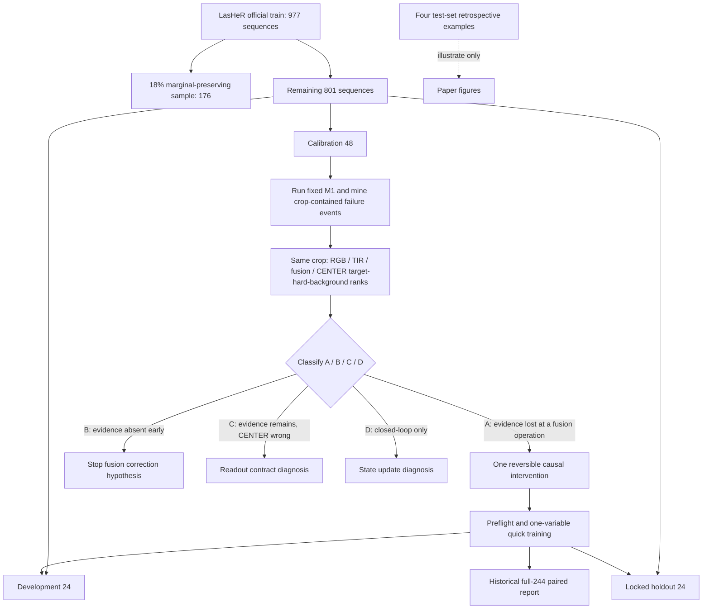

# M1 Screening Protocol V1

## Purpose

This package fixes the data roles for the M1 frame-level target-versus-hard-background ranking study. It does not claim that a module improves tracking. The protected parent remains `TBSI_E_MHSA_FULL_4090D_seed42`, epoch 15.

## Flow



## Data roles

| Asset | Membership | Use | Evidence limit |
|---|---:|---|---|
| `quick_train_manifest.json` | 176 of 977 official LasHeR train sequences (18.01%) | Short, matched candidate training | M1 was trained on all official train sequences. This is a candidate-training subset, not a held-out evaluation set. |
| Calibration / development / locked holdout manifests | 48 / 24 / 24 train sequences, disjoint from quick-train | Discover M1 events, test one frozen hypothesis, then evaluate the selected candidate once | Held out from candidate updates, but not unseen to the M1 parent checkpoint. |
| `full244_eval_manifest.json` | All 244 official LasHeR test sequences | Required paired screening evaluation | The split has extensive prior exposure in this project. Report it as historical full-244 evaluation, not an untouched holdout. |
| Historical RPP-v1 test manifest | 60 of 244 official test sequences | Optional low-cost pressure subset only | RPP-v1 oversamples rare attributes and has prior experiment exposure. Never substitute its macro score for full-244. |
| `paper_case_events.csv` | Four archived test-set event windows | Retrospective, concrete case illustrations | These cases were already inspected. They cannot select modules, tune thresholds, or validate a new claim. |

The training sample is selected to keep full-training-set marginal proportions for all 19 overlapping official attributes and four scene proxy quartiles. The proxies are median target area fraction, 90th-percentile target-relative motion, RGB target luminance, and TIR target-to-local-ring contrast. Selection uses deterministic hash initialization and fixed-count swap descent. It does not deliberately enrich rare attributes. The LasHeR loader skip list is applied. All members and hashes are recorded in the manifests. Maximum absolute official attribute count deviation is about one sequence.

## Event definition

The four paper cases are taken from the first archived persistent severe event matching the report's frozen definition: valid GT, IoU below 0.2 for at least 30 consecutive frames. The case window is a historical system-failure example, not automatically a target-hard-background ranking event. Before writing a causal claim, manually verify target visibility, nearby distractors, annotation quality, the same crop/state, and CENTER score decoding. Record target and strongest non-target score/rank before and after each relevant model stage.

`calibration_sequences.txt`, `development_sequences.txt`, and `locked_holdout_sequences.txt` are generated from the 801 official train sequences not assigned to candidate training. The candidate correction must train only on the 176 member `quick_train` list. Run the frozen M1 parent on these cohorts to mine events, then classify them using `event_annotation_template.csv`. Calibration may define extraction thresholds and repair capture contracts; development may test one frozen hypothesis; locked holdout is opened once after candidate design is frozen. A sequence can appear in only one role. Since M1 saw all LasHeR train sequences during fitting, these cohorts are held out from candidate updates, not unseen to the parent. Test-set cases remain retrospective. A fresh external benchmark is needed for an independent generalization claim.

Classify each event before proposing an operator:

- A: target evidence exists before fusion and target-versus-hard-background rank declines after a specific fusion operation.
- B: both modalities lack target evidence at the earliest measured stage.
- C: fused features retain target evidence, but CENTER selects the wrong location or decodes the box poorly.
- D: the same-frame fixed-state result is acceptable, while subsequent state updates cause drift or loss of crop coverage.

Only A admits a fusion correction hypothesis. B requires an upstream representation or data explanation. C calls for a readout contract diagnosis. D belongs to state update and recovery. A feature norm or cosine change alone does not assign a class.

## Training and comparison contract

1. Freeze the hypothesis, one changed variable, parent checkpoint, config, code snapshot, sequence manifests, metric definitions, and expected signal direction before running a candidate.
2. Candidate and direct-parent control use the same train manifest, resolution, backbone, optimizer, batch, precision, sample-generation policy, seed, optimizer steps, checkpoint rule, and evaluator.
3. M1 full training uses 59,904 sampled pairs per epoch, batch 16, accumulation 8, and 15 epochs: 3,744 microbatches and 468 optimizer updates per epoch, 7,020 optimizer updates total. The 18% quick budget is 1,264 optimizer updates (about 161,792 sampled pairs at effective batch 128). Scale warmup and decay by the same optimizer-step ratio. Record actual optimizer updates and sample exposure; do not equate epochs when dataset sizes differ.
4. Run no-op/zero-gate parity, shape and save-load checks, one-batch gradient checks, frozen-parent drift checks, and a fixed-small-sample fit check before the quick screen.
5. Evaluate the candidate on the 24-sequence development cohort during iteration and preserve the 24-sequence locked holdout until design freeze. Because evaluation is affordable, also report all 244 test sequences for historical comparability; these scores are selection-exposed and cannot be called independent confirmation. If a 60-sequence RPP pressure run is used for triage, retain full-244 evaluation and report both separately.
6. Report full-244 AUC, Precision, Norm Precision, OP50, OP75, paired per-sequence deltas, wins/ties/losses, attribute strata, and event-class strata. State when a macro gain is concentrated in a few sequences.
7. If proxy and full results disagree, compare per-sequence deltas by attributes and target-evidence class, then compare learning curves by optimizer step. Determine whether the disagreement comes from omitted strata, progress mismatch, or a failed mechanism before changing the idea.
8. Promote only after the mechanism signal has the predicted direction on locked train-side holdout, full-244 results are directionally consistent, and no unexamined stratum has concentrated severe regression. Final paper claims need multiple seeds and an external benchmark for independent generalization.

## Historical proxy calibration

Do not use RPP-v1 as a fresh holdout. Before using a proxy to rank candidates, audit historical runs for matched parent, initialization, training data, optimizer steps, seed, checkpoint, and evaluator. Include positive, negative, and null full-result cases. Compute proxy-versus-full rank correlation and direction agreement only on comparable pairs, with sequence bootstrap uncertainty. If the sample is too small or rankings disagree, the proxy is not calibrated and cannot gate expensive full training.

Current assets establish at least one proxy/full reversal (Cdiag) and several short screens with different training/evaluation contracts. This rejects unqualified proxy ranking but does not estimate a trustworthy Spearman coefficient. A matched historical audit is a required gate before batch-screening new ideas.

The completed audit is in [m1_proxy_calibration_audit_20261022.md](../../reports/m1_proxy_calibration_audit_20261022.md). Only two historical proxy/full direction pairs are usable; one agrees and one reverses. Sequence-level Spearman is `NA`, not estimated from two candidate aggregates.

## First M1 improvement study

Start with an evidence-location study, not module training. On fixed same-crop/template/state events, compare target and strongest hard-background rank at block outputs, TBSI locations 3/6/9, `tbsi_fuse_search` input/output, and CENTER. For one location at a time, apply a reversible intervention and a non-target-position control. A candidate enters training only if the intervention changes target/background ordering in the expected direction and that change reaches CENTER. Keep template updating outside this study.

## Status after fixed-state study (2026-10-22)

- Current-source M1 replay parity passed on 48 frozen historical events; this validates the diagnostic execution path, not a new method.
- The calibration cohort produced 23 crop-contained persistent-failure onsets. The corrected common query metric covered 46 fixed states and reproduced trace IoU exactly.
- On the 23 calibration onset pairs, CENTER GT top-1 fell from 22/23 at the preceding frame to 11/23 at onset. The largest adjacent observational rank loss was block10 to block11, but the reversible block11 bypass result was skewed and harmed many pre-onset states.
- The frozen one-time development check found 15 events in 24 sequences. CENTER GT top-1 fell from 14/15 to 7/15, confirming the event class. Block11 bypass did not outperform the block05 non-target-position control, so block11-specific training is not admitted.
- The active problem definition is crop-contained frame-local target/hard-background ranking failure. No single first-cause operator is established. Reversible block02/TBSI/search-fusion interventions and early-margin signal audits are complete; none establishes a stable hand-designed gate. A single trainable candidate is preregistered: predict per-modality target utility from early features and supervise the router with one detached CENTER target-minus-hard-background utility distribution on candidate-train samples. Calibration is used only to test ranking/regret before candidate updates.
- The 24-sequence locked holdout remains closed. Historical full-244 results remain selection-exposed. The proxy remains uncalibrated.

The detailed evidence, intervention outputs, and next-route boundary are recorded in [m1_screening_fixed_state_flow_calibration_20261022.md](../../reports/m1_screening_fixed_state_flow_calibration_20261022.md). The candidate contract is in `candidate_utility_router_v1_prereg.md`. Implementation and contract preflight must pass before the single quick-train run; the locked holdout remains sealed.

Implementation preflight passed on 2026-10-22, but the candidate's calibration utility gate failed: utility CE was worse than the train-derived constant prior even though mean regret beat random modality choice. The registered 1,264-update screen was not launched; see [m1_early_utility_router_preflight_20261022.md](../../reports/m1_early_utility_router_preflight_20261022.md). At that point, development and locked holdout had not been opened; development was subsequently used once for the block11 direction, and locked holdout remains unopened.

## Sparse candidate-conditioned neck fusion (2026-10-22)

The early utility router did not pass its calibration gate. A separate sparse candidate-conditioned neck route was tested at fixed state with an equal-density spatially shifted control. The target-conditioned mask covered a mean 91.35% of GT cells at 20.01% grid density; its CENTER GT-hard-background margin exceeded the parent by `+0.0111` and the shifted control by `+0.0446` on average. The shifted control did not reproduce the margin effect. CENTER GT rank and IoU remain inconclusive, so this supports the target-conditioned interaction mechanism only, not tracking improvement. See [m1_sparse_cross_neck_shifted_control_20261022.md](../../reports/m1_sparse_cross_neck_shifted_control_20261022.md).

The next permitted step is the already specified matched parent/candidate quick screen using the 176-sequence training proxy, seed 42, the same M1 epoch-15 initialization, 16 epochs / 1,264 optimizer steps, and the original tracking losses. The parent quick run is complete. Candidate retry1 was interrupted during epoch 10 with epoch 8 as its latest checkpoint. A resume from epoch 8 restarted the process RNG at epoch 9, so it was stopped before saving another checkpoint and excluded from matched comparison. Retry2 uses a new config and output directory and starts fresh from M1 epoch15. Do not tune top-k or dilation from calibration. The development split has already been used for the block11 hypothesis; keep the locked holdout closed until the sparse candidate is frozen after this screen.

## Reproduction

From `TBSI_gai/TBSI` run:

```bash
python tools/build_m1_screening_protocol_20261022.py
python tools/build_m1_event_cohorts_20261022.py
python tools/finalize_m1_screening_protocol_20261022.py
```

Both builders refuse to overwrite generated assets. The cohort builder reads LasHeR GT/image pairs and official attribute labels. The initial screen manifest also reads archived M1 full-244 scene-mining outputs. The finalizer verifies cohort sizes, disjointness, attribute balance and records SHA256 for protocol assets and source scripts. `abandoned_checkpoint_cleanup_20261022.json` records the exact deleted weights and pre-deletion hashes; experiment reports and prediction files remain. Keep source records to regenerate the protocol.
