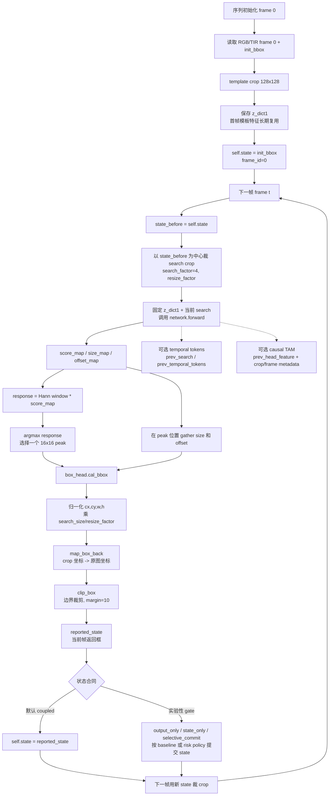

# 当前 TBSI 完整推理链路与跟踪闭环

本文按当前工作树代码绘制。实线是默认 M1 主链；虚线是配置或环境变量打开时才会进入的实验路径。默认 M1 配置关闭 IGF、MSHA、TAM、temporal tokens、degradation-aware fusion 和所有 readout gate。

## 1. 单帧推理数据流

```mermaid
flowchart TD
    A[当前帧 RGB/TIR 图像] --> B[按 self.state 裁 search crop<br/>search_factor=4, size=256]
    T0[首帧 RGB/TIR 图像 + init_bbox] --> T1[模板 crop<br/>template_factor=2, size=128]
    T1 --> T2[Preprocessor<br/>RGB/TIR 分开得到 template tensors]
    B --> B1[Preprocessor<br/>RGB/TIR 分开得到 search tensors]
    T2 --> C[ViT patch embedding<br/>128x128/16 -> 8x8=64 tokens per modality]
    B1 --> D[ViT patch embedding<br/>256x256/16 -> 16x16=256 tokens per modality]
    C --> E[加 template positional embedding]
    D --> F[加 search positional embedding]
    E --> G[每模态拼接 template+search<br/>RGB 320 tokens, TIR 320 tokens]
    F --> G
    G --> H[12 个共享参数 ViT blocks<br/>RGB 流与 TIR 流分别前向]
    H --> I{TBSI_LOC 命中的 block?}
    I -->|默认 M1: 3,6,9| J[TBSI template-bridged interaction]
    J --> H
    I -->|完成全部 blocks| K[recover_tokens + LayerNorm]
    K --> L[拼接 RGB/TIR 输出<br/>cat_feature=[B,640,768]]
    L --> M[RGB search: 64:320<br/>[B,256,768]]
    L --> N[TIR search: 384:640<br/>[B,256,768]]
    M -.-> O[可选 IGFPreFusion<br/>search query, template RGB/TIR KV<br/>bounded residual]
    N -.-> O
    L -.-> O
    O --> P[拼接 RGB/TIR search<br/>[B,256,1536] -> [B,1536,16,16]]
    M --> P
    N --> P
    P --> Q[tbsi_fuse_search<br/>3x3 Conv + BatchNorm + ReLU<br/>[B,768,16,16]]
    Q -.-> R[可选 post-fusion adapter<br/>MSHA / target local / complementary]
    Q --> U[CENTER head]
    R -.-> U
    U --> U1[center branch<br/>score_map [B,1,16,16], sigmoid]
    U --> U2[size branch<br/>size_map [B,2,16,16], sigmoid]
    U --> U3[offset branch<br/>offset_map [B,2,16,16]]
```

### 代码对应

- 输入和 backbone：[`tbsi_track.py`](/root/autodl-tmp/TBSI_gai/TBSI/lib/models/tbsi_track/tbsi_track.py:330)、[`vit_tbsi_care.py`](/root/autodl-tmp/TBSI_gai/TBSI/lib/models/tbsi_track/vit_tbsi_care.py:258)
- TBSI 循环：[`vit_tbsi_care.py`](/root/autodl-tmp/TBSI_gai/TBSI/lib/models/tbsi_track/vit_tbsi_care.py:294)
- token 切分、IGF 和 `tbsi_fuse_search`：[`tbsi_track.py`](/root/autodl-tmp/TBSI_gai/TBSI/lib/models/tbsi_track/tbsi_track.py:432)
- 可选 MSHA 插入点：[`tbsi_track.py`](/root/autodl-tmp/TBSI_gai/TBSI/lib/models/tbsi_track/tbsi_track.py:545)
- CENTER 三分支：[`tbsi_track.py`](/root/autodl-tmp/TBSI_gai/TBSI/lib/models/tbsi_track/tbsi_track.py:580)、[`head.py`](/root/autodl-tmp/TBSI_gai/TBSI/lib/models/layers/head.py:197)

## 2. CENTER 解码与跨帧跟踪闭环



### CENTER 的实际选择顺序

1. `pred_score_map` 与固定 Hann window 相乘得到 `response`。
2. `cal_bbox` 对 `response.flatten(1)` 做 `torch.max`，只选一个 peak。
3. 在 peak 位置读取 `size_map` 和 `offset_map`。
4. 生成归一化 `[cx, cy, w, h]`，乘搜索尺寸后映射回原图并执行 `clip_box`。
5. 默认 `readout_state_mode=coupled` 时，返回框和下一帧 crop 状态都是 `reported_state`。
6. 默认没有模板更新；`z_dict1` 在初始化后保持不变。

## 3. 评测外层循环

```mermaid
flowchart LR
    D[LasHeR sequence<br/>visible + infrared + GT] --> E[Tracker.run_sequence]
    E --> E1[预加载双模态帧]
    E1 --> E2[initialize(frame0, init_bbox)]
    E2 --> E3[逐帧 track(frame_t, previous_output)]
    E3 --> E4[保存 target_bbox 与 time]
    E4 --> E5[官方 evaluator<br/>Success/AUC, Precision, NPR, OP50, OP75]
```

评测入口只负责序列循环和结果保存；crop、网络、解码和状态逻辑都在 tracker 内部。具体入口见 [`tracker.py`](/root/autodl-tmp/TBSI_gai/TBSI/lib/test/evaluation/tracker.py:137) 和 [`tbsi_track.py`](/root/autodl-tmp/TBSI_gai/TBSI/lib/test/tracker/tbsi_track.py:237)。

## 4. 当前实现中容易混淆的点

- `tbsi_fuse_search` 不是简单平均，而是默认 `Conv2d(1536,768,3x3)+BN+ReLU`。
- TBSI 发生在 backbone 的指定 block 内；IGF 若启用，是最终 TBSI 输出之后、该 Conv 融合之前。
- CENTER 先用 Hann 后的 score 选一个 peak，再取该位置的 size/offset；不是在所有候选框上做几何平均。
- 首帧模板只初始化一次；默认跨帧变化来自 `self.state` 反馈后的 search crop，而不是模板更新。
- 当前 M1 默认关闭所有实验性 adapter；图中的虚线只有对应配置或环境变量打开时才存在。
